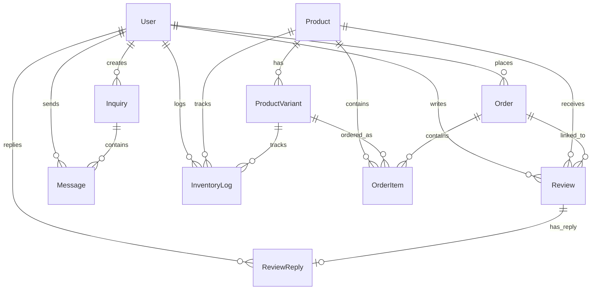

# Database Architecture

## Overview

The application uses **PostgreSQL** as the primary database, accessed through **Prisma ORM v7**. The schema is defined in `backend/prisma/schema.prisma`.

---

## Entity Relationship Diagram

---

## Models

### User
Primary entity for all user types (customer, admin, sales).

| Column | Type | Constraints | Description |
|--------|------|-------------|-------------|
| id | Int | PK, Auto-increment | |
| name | String | Required | Full name |
| email | String | Unique, Required | Login email |
| password | String | Required | bcrypt hashed |
| role | String | Default: "customer" | customer, admin, sales |
| status | String | Default: "active" | active, suspended, deleted |
| deletedAt | DateTime? | Nullable | Soft-delete timestamp |
| avatarUrl | String? | Nullable | Profile image URL |
| contactNumber | String? | Nullable | Phone number |
| address | String? | Nullable | Street address |
| city | String? | Nullable | |
| province | String? | Nullable | |
| zipCode | String? | Nullable | |
| isEmailVerified | Boolean | Default: false | OTP verification status |
| otpCode | String? | Nullable | Email verification OTP |
| otpExpiresAt | DateTime? | Nullable | OTP expiration |
| lastOtpSentAt | DateTime? | Nullable | Rate limiting |
| resetOtpCode | String? | Nullable | Password reset OTP |
| resetOtpExpiresAt | DateTime? | Nullable | Reset OTP expiration |
| sessionToken | String? | Nullable | Single-session enforcement |
| createdAt | DateTime | Default: now() | |

### Product
Roofing product catalog.

| Column | Type | Constraints | Description |
|--------|------|-------------|-------------|
| id | Int | PK, Auto-increment | |
| name | String | Unique, Required | Product name |
| type | String | Required | e.g., Spandrel, Rib, Flat Type |
| description | String? | Nullable | Rich text description |
| price | Float | Required | Base selling price (after discount) |
| originalPrice | Float? | Nullable | Pre-discount original price |
| discountPercent | Float | Default: 30 | Discount percentage (default 30%) |
| unit | String | Default: "per meter" | Unit of measurement |
| stock | Int | Required | Base stock (fallback) |
| imageUrl | String? | Nullable | Primary image |
| imageUrls | String[] | Default: [] | Additional images |
| isPreOrder | Boolean | Default: true | Flags made-to-order custom roll-formed products |
| isActive | Boolean | Default: true | Controls visibility in customer catalog (true = visible, false = disabled/hidden) |
| effectiveWidth | Float? | Nullable | Profile effective coverage width (mm) |
| nominalWidth | Float? | Nullable | Profile nominal raw width (mm) |
| ribHeight | Float? | Nullable | Profile rib height (mm) |
| thickness | String? | Nullable | Base thickness gauge (e.g., 0.35mm) |
| colors | String[] | Default: [] | Official Mega Pacific available colors |
| maxMeters | Float | Default: 21.0 | Maximum custom cut length (meters) |
| averageRating | Float | Default: 0 | Calculated average |
| reviewCount | Int | Default: 0 | Total review count |
| createdAt | DateTime | Default: now() | |
| updatedAt | DateTime | Auto-updated | |

### ProductVariant
Pricing variants for products (thickness options e.g., 0.40mm, 0.50mm, 0.60mm).

| Column | Type | Constraints | Description |
|--------|------|-------------|-------------|
| id | Int | PK, Auto-increment | |
| productId | Int | FK → Product | Parent product |
| name | String | Required | Variant display name (e.g., 0.40mm) |
| thickness | String? | Nullable | Thickness gauge string |
| price | Float | Required | Selling price per meter (after discount) |
| originalPrice | Float? | Nullable | Pre-discount original price |
| discountPercent | Float | Default: 30 | Discount percentage (default 30%) |
| stock | Int | Required | Variant-specific stock |
| sku | String? | Nullable | Optional SKU code |
| status | String | Default: "available" | available, out_of_stock |
| createdAt | DateTime | Default: now() | |
| updatedAt | DateTime | Auto-updated | |

### Order
Customer purchase orders.

| Column | Type | Constraints | Description |
|--------|------|-------------|-------------|
| id | Int | PK, Auto-increment | |
| userId | Int | FK → User | Customer who placed order |
| total | Float | Required | Order total amount |
| status | String | Default: "pending" | pending, processing, shipped, completed |
| paymentStatus | String | Default: "unpaid" | Payment state |
| paymentMode | String | Default: "Cash on Delivery" | Payment method |
| fulfillmentType | String | Default: "Delivery" | Delivery or Pickup |
| customerName | String? | Nullable | Snapshot of customer name |
| customerEmail | String? | Nullable | Snapshot of customer email |
| shippingName | String? | Nullable | Recipient name |
| shippingContactNumber | String? | Nullable | Recipient phone |
| shippingAddress | String? | Nullable | Delivery address |
| shippingCity | String? | Nullable | |
| shippingProvince | String? | Nullable | |
| shippingZipCode | String? | Nullable | |
| notes | String? | Nullable | Order notes |
| estimatedDeliveryDate | DateTime? | Nullable | Set automatically on delivery |
| statusUpdatedAt | DateTime? | Nullable | Timestamp of last status change (used by auto-scheduler) |
| createdAt | DateTime | Default: now() | |

### OrderItem
Individual line items within an order.

| Column | Type | Constraints | Description |
|--------|------|-------------|-------------|
| id | Int | PK, Auto-increment | |
| orderId | Int | FK → Order | Parent order |
| productId | Int | FK → Product | Ordered product |
| variantId | Int? | FK → ProductVariant | Ordered variant (optional) |
| variantName | String? | Nullable | Snapshot of variant name at purchase |
| quantity | Int | Required | Number of sheets/units |
| price | Float | Required | Price per unit/meter at time of purchase |
| color | String? | Nullable | Selected color |
| customLength | Float? | Nullable | Custom roll-formed length in meters |
| thickness | String? | Nullable | Thickness gauge snapshot (e.g., 0.40mm) |

### Review
Product reviews submitted by customers.

| Column | Type | Constraints | Description |
|--------|------|-------------|-------------|
| id | Int | PK, Auto-increment | |
| productId | Int | FK → Product | Reviewed product |
| userId | Int | FK → User | Reviewer |
| rating | Int | Default: 5 | 1-5 star rating |
| title | String? | Nullable | Review title |
| comment | String? | Nullable | Review text |
| imageUrls | String[] | Default: [] | Review images |
| orderId | Int? | FK → Order | Linked order (optional) |
| createdAt | DateTime | Default: now() | |

### ReviewReply
Staff replies to customer reviews.

| Column | Type | Constraints | Description |
|--------|------|-------------|-------------|
| id | Int | PK, Auto-increment | |
| reviewId | Int | FK → Review, Unique | One reply per review |
| userId | Int | FK → User | Staff replying |
| comment | String | Required | Reply text |
| createdAt | DateTime | Default: now() | |

### Inquiry
Customer service tickets.

| Column | Type | Constraints | Description |
|--------|------|-------------|-------------|
| id | Int | PK, Auto-increment | |
| customerId | Int | FK → User | Customer who created |
| subject | String? | Nullable | Inquiry subject |
| status | String | Default: "Open" | Open, In Progress, Resolved |
| createdAt | DateTime | Default: now() | |
| updatedAt | DateTime | Auto-updated | |

### Message
Messages within an inquiry thread.

| Column | Type | Constraints | Description |
|--------|------|-------------|-------------|
| id | Int | PK, Auto-increment | |
| inquiryId | Int | FK → Inquiry | Parent inquiry (cascade delete) |
| senderId | Int | FK → User | Message author |
| content | String | Required | Message text |
| createdAt | DateTime | Default: now() | |

### ProductType
Product categorization.

| Column | Type | Constraints | Description |
|--------|------|-------------|-------------|
| id | Int | PK, Auto-increment | |
| name | String | Unique, Required | Type name |
| description | String? | Nullable | |
| createdAt | DateTime | Default: now() | |

### InventoryLog
Audit trail for stock changes.

| Column | Type | Constraints | Description |
|--------|------|-------------|-------------|
| id | Int | PK, Auto-increment | |
| productId | Int | FK → Product (cascade) | |
| variantId | Int? | FK → ProductVariant (set null) | |
| addedBy | Int? | FK → User (set null) | Staff who made the change |
| previousStock | Int | Required | Stock before adjustment |
| addedQuantity | Int | Required | Quantity added |
| newStock | Int | Required | Stock after adjustment |
| reason | String? | Default: "Restock" | Reason for adjustment |
| createdAt | DateTime | Default: now() | |

### CoilInventory
Raw steel material master coils tracked in physical coil counts (rolls) per thickness gauge and color finish across 14 standard colors.

| Column | Type | Constraints | Description |
|--------|------|-------------|-------------|
| id | Int | PK, Auto-increment | |
| name | String | Required | Coil display identifier |
| thickness | String | Required | Standard gauge (e.g., 0.35mm, 0.40mm, 0.50mm, 0.60mm) |
| color | String | Required | Official Mega Pacific color (14 colors) |
| coilCount | Int | Default: 1 | Physical count of master rolls in stock |
| minAlertCount | Int | Default: 1 | Low-stock threshold alert margin in rolls |
| availableMeters | Float | Default: 0 | Legacy / reference roll length in linear meters |
| minAlertMeters | Float | Default: 200 | Legacy low-stock threshold alert margin |
| createdAt | DateTime | Default: now() | |
| updatedAt | DateTime | Auto-updated | |

### CoilInventoryLog
Audit trail for material deductions per order/waste and restocking receipts in roll count.

| Column | Type | Constraints | Description |
|--------|------|-------------|-------------|
| id | Int | PK, Auto-increment | |
| coilId | Int | FK → CoilInventory (cascade) | Target raw coil |
| userId | Int? | FK → User (set null) | Logistics or staff member performing action |
| orderId | Int? | FK → Order (set null) | Customer order ID reference |
| previousCount | Int | Default: 0 | Stock roll count prior to transaction |
| coilsDeducted | Int | Default: 0 | Coil rolls consumed (positive) or replenished (negative) |
| remainingCount | Int | Default: 0 | Stock roll count after transaction |
| previousMeters | Float | Default: 0 | Legacy stock meters prior to transaction |
| metersDeducted | Float | Default: 0 | Legacy meters consumed or replenished |
| remainingMeters | Float | Default: 0 | Legacy stock meters after transaction |
| actionType | String | Default: "deduction" | Action performed: deduction, restock, adjustment |
| reason | String? | Nullable | Order cutting reference, scrap, or supplier delivery receipt |
| createdAt | DateTime | Default: now() | |

### Refund
Financial refund requests generated when Sales staff rejects an order, processed by Finance staff.

| Column | Type | Constraints | Description |
|--------|------|-------------|-------------|
| id | Int | PK, Auto-increment | Primary key |
| orderId | Int | UK, FK → Order (cascade) | Order linked to refund |
| userId | Int | FK → User (cascade) | Customer receiving refund |
| amount | Float | Required | Refund amount (50% downpayment or 100% total) |
| paymentMethod | String | Required | Original payment channel details (GCash, Card, Bank) |
| reason | String? | Nullable | Sales rejection justification |
| status | String | Default: "pending" | pending, completed, failed |
| processedBy | Int? | FK → User (set null) | Finance staff ID who processed the refund |
| transactionReference | String? | Nullable | Bank reversal or GCash transaction reference number |
| notes | String? | Nullable | Finance processing notes |
| refundedAt | DateTime? | Nullable | Timestamp when finance issued the refund |
| createdAt | DateTime | Default: now() | |
| updatedAt | DateTime | Auto-updated | |

---

## Key Relationships

| Relationship | Type | On Delete |
|-------------|------|-----------|
| Product → ProductVariant | One-to-Many | Cascade |
| Order → OrderItem | One-to-Many | — |
| Review → ReviewReply | One-to-One | Cascade |
| Inquiry → Message | One-to-Many | Cascade |
| Product → InventoryLog | One-to-Many | Cascade |
| ProductVariant → InventoryLog | One-to-Many | Set Null |
| User → InventoryLog | One-to-Many | Set Null |
| CoilInventory → CoilInventoryLog | One-to-Many | Cascade |
| User → CoilInventoryLog | One-to-Many | Set Null |
| Order → CoilInventoryLog | One-to-Many | Set Null |
| Order → Refund | One-to-One | Cascade |
| User → Refund (Customer) | One-to-Many | Cascade |
| User → Refund (Finance Staff) | One-to-Many | Set Null |
