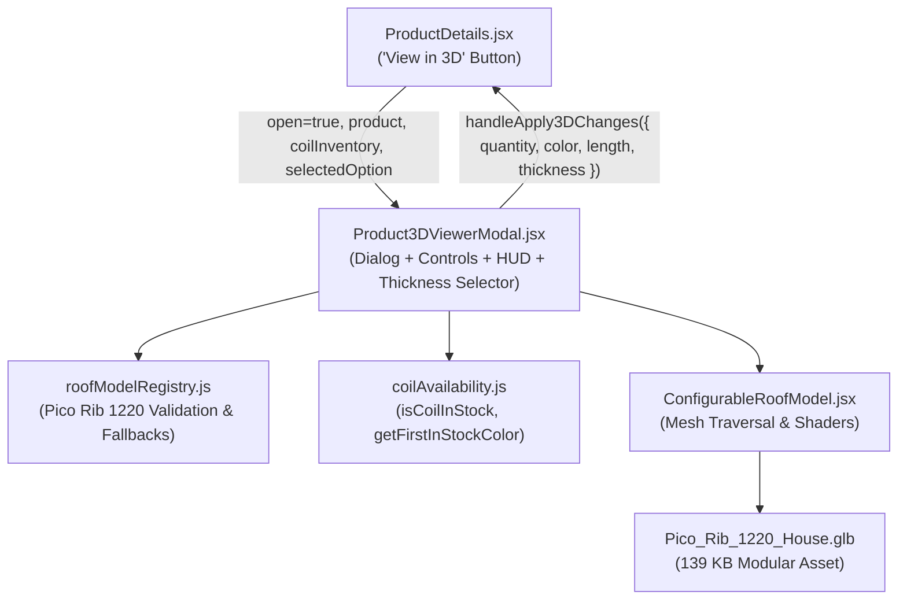

# 3D Roof Visualizer & Model Integration Specification

## Overview
The 3D Roof Visualizer allows customers to inspect their selected roofing profile, color, thickness, and cut length on interactive 3D house structures directly from the **Product Details** page (`ProductDetails.jsx`).

Rather than treating 3D visualization as an isolated sandbox, the visualizer connects directly to the customer's active order intent with **Quantity-Accurate Rendering** and **Live Coil Inventory Validation**:
- Dedicated profile models: Products with dedicated models (ex. **Pico Rib 1220**) load their exact architectural profile. Other products (ex. **Mega Twin Rib**) show a clean informative message: `"Nothing available model for this product"`.
- If a customer configures an order for 10 sheets on a 16-sheet roof, exactly 10 sheets are installed in the 3D model, while the remaining 6 slots leave the timber purlins, rafters, and framing exposed.
- Customers can switch thickness (0.35mm, 0.40mm, 0.50mm, 0.60mm), and the color swatches validate in real-time against raw steel coil inventory (`coilInventory`).
- Clicking **Apply Changes to Order** syncs the chosen thickness, color, sheet quantity, and cut length directly back to the customer's product order form.

---

## Architecture & Components

### 1. `Product3DViewerModal.jsx`
- **Location**: `frontend/src/components/Product3DViewerModal.jsx`
- **Role**: Main dialog containing the Three.js Canvas, OrbitControls, in-canvas coverage HUD, camera view toolbar, thickness selector, and coil inventory color swatch validator.
- **Key Features**:
  - **Product Profile Validation**: If `!isProfileSupported`, displays the `"Nothing available model for this product"` screen.
  - **Thickness Selection**: Allows choosing between `0.35mm`, `0.40mm`, `0.50mm`, `0.60mm`.
  - **Coil Inventory Validation**: Evaluates `isCoilInStock(coilInventory, thickness, color)`. Colors that have zero stock in raw coils for the active thickness are dimmed and marked out-of-stock. Switching thickness automatically shifts to an available in-stock color.
  - **Enlarged Canvas & Fullscreen**: Responsive width up to 1550px, 92vh height, with a top-bar toggle for 100vw × 100vh fullscreen.
  - **Camera Controls**: In-canvas toolbar for "Default View", "Front Slope", "Roof Top", and Zoom In/Out.

### 2. `roofModelRegistry.js`
- **Location**: `frontend/src/services/roofModelRegistry.js`
- **Validation Rules**:
  - `isPicoRib1220(productName)`: Case-insensitive regex matching `/pico\s*rib\s*1220/i`.
  - Only Pico Rib 1220 resolves to `Pico_Rib_1220_House.glb`.
  - Any other product (ex. Mega Twin Rib) returns `{ isProfileSupported: false, message: 'Nothing available model for this product' }`.

### 3. 3D Asset Specification: `Pico_Rib_1220_House.glb`
- **Model Path**: `/models/house/Pico_Rib_1220_House.glb` (and `/models/house/Starter_House_6x6.glb`)
- **File Size**: **139 KB**
- **Profile Features**:
  - Effective width: 1013mm
  - Nominal width: 1080mm
  - 5 major trapezoidal ribs (height: 28mm, pitch: 253mm, crest flat: 52mm)
  - 2 mini-stiffener pico waves per pan bay
  - 16 sequentially addressable sheets (`RoofSheet_01` to `RoofSheet_16`)
  - 5 solid timber A-frame trusses with tie beams and king posts
  - 10 timber purlins and underlayment
  - Ridge cap, rake flashings, rain gutters, concrete foundation, and stucco walls

---

## User Interaction Flow
1. **Pico Rib 1220 Product Page**:
   - Customer clicks **"View in 3D"**.
   - The visualizer opens close-up with the authentic Pico Rib 1220 profile (28mm major ribs and pico wave pans).
   - Customer selects thickness (`0.35mm`, `0.40mm`, `0.50mm`, `0.60mm`).
   - Color swatches update to reflect available steel coils in stock for that specific thickness.
   - Adjusting sheets shows installed panels vs exposed purlins.
   - Clicking **"Apply Changes to Order"** updates the thickness, color, sheet count, and cut length on the product page.
2. **Non-Pico Products (ex. Mega Twin Rib)**:
   - Customer clicks **"View in 3D"**.
   - The visualizer displays:
     > *"Nothing available model for this product"*  
     > *"Our interactive 3D model visualization is currently built and tailored specifically for Pico Rib 1220 roofing sheets. A dedicated 3D profile model for Mega Twin Rib is currently in development."*
   - Customer clicks **"Return to Product Details"** to continue ordering.
