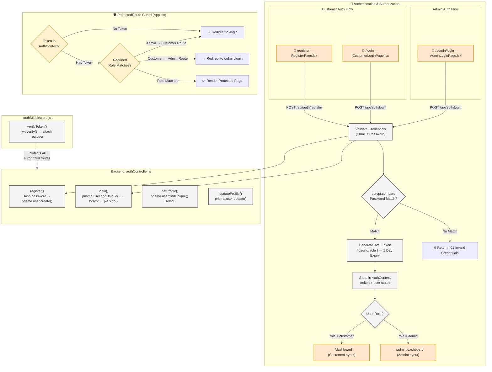
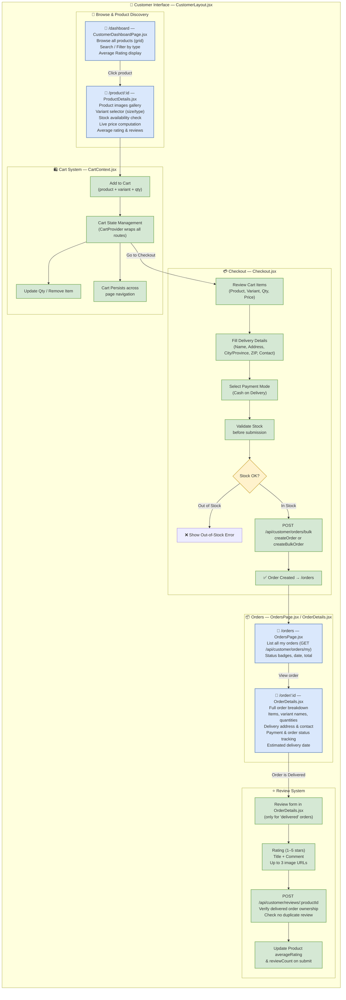
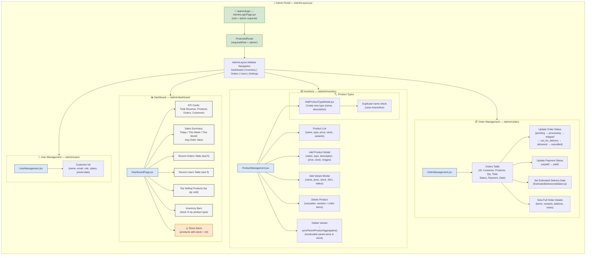
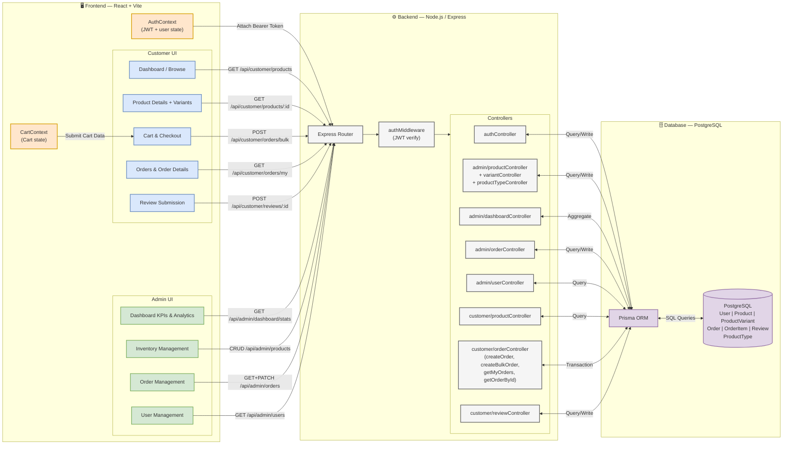

# 🔄 System Flowchart — Mega Pacific Roofing System

This document outlines the **current, complete flow** of the **Mega Pacific Metal & Steel Corp — Roofing Product Management System**, covering Authentication, Customer Interface, Admin Dashboard, Backend API, and Database layers.

---

## 📋 Module Index

| Module | Description |
|---|---|
| [1. Authentication & Authorization](#1-authentication--authorization-module) | Registration, Login, JWT, Role-based Guards |
| [2. Customer Interface](#2-customer-interface-module) | Browse, Product Details, Cart, Checkout, Orders, Reviews |
| [3. Admin Dashboard](#3-admin-dashboard-module) | Dashboard, Inventory, Orders, Users |
| [4. Backend API & Business Logic](#4-backend-api--business-logic) | Express Routes, Controllers, Middleware |
| [5. Database & Data Models](#5-database--data-models) | PostgreSQL via Prisma ORM |

---

## 1. Authentication & Authorization Module

Handles Registration, Login, JWT token generation, and role-based route protection for both Customer and Admin portals.



---

## 2. Customer Interface Module

Full customer journey: browsing products, viewing details, selecting variants, managing a cart, completing checkout, tracking orders, and submitting reviews.



---

## 3. Admin Dashboard Module

Admin-only portal with role-guarded access, providing full visibility into system analytics, inventory, orders, and user management.



---

## 4. Backend API & Business Logic

All routes, controllers, and middleware that power the system. Organized by admin and customer namespaces.

```mermaid
flowchart TD
    classDef route fill:#ffe6cc,stroke:#d79b00,stroke-width:2px;
    classDef controller fill:#f5f5f5,stroke:#666666,stroke-width:2px;
    classDef middleware fill:#d5e8d4,stroke:#82b366,stroke-width:2px;
    classDef transaction fill:#dae8fc,stroke:#6c8ebf,stroke-width:2px;

    subgraph BackendAPI ["⚙️ Backend API — Express.js (server.js)"]
        direction TB

        MW["🛡️ authMiddleware.js\njwt.verify() → req.user\n(Applied to all protected routes)"]

        subgraph AuthRoutes ["/api/auth — authRoutes.js"]
            AR1["POST /register → register()"]
            AR2["POST /login → login()"]
            AR3["GET /profile → getProfile() [auth]"]
            AR4["PUT /profile → updateProfile() [auth]"]
        end

        subgraph AdminRoutes ["🔒 Admin Routes (require admin role)"]
            subgraph AdminProduct ["/api/admin/products — productRoutes.js"]
                AP1["GET / → getProducts()"]
                AP2["POST / → createProduct()"]
                AP3["DELETE /:id → deleteProduct() [cascade]"]
                AP4["GET /:productId/variants → getVariants()"]
                AP5["POST /:productId/variants → createVariant()\n→ syncParentProductAggregates()"]
                AP6["DELETE /:productId/variants/:id → deleteVariant()\n→ syncParentProductAggregates()"]
            end

            subgraph AdminDashboard ["/api/admin/dashboard — dashboardRoutes.js"]
                AD1["GET /stats → getDashboardStats()\nAggregates: revenue, users, orders\nRecent orders, recent users\nTop products, stock alerts\nInventory bars, sales summary"]
            end

            subgraph AdminOrders ["/api/admin/orders — orderRoutes.js"]
                AO1["GET / → getOrders()\n(with user, items, product, variant)"]
                AO2["PATCH /:id/status → updateOrderStatus()\n→ EstimatedDeliveryValidator"]
            end

            subgraph AdminUsers ["/api/admin/users — userRoutes.js"]
                AU1["GET / → getUsers()"]
            end

            subgraph AdminProductTypes ["/api/admin/product-types — productTypeRoutes.js"]
                APT1["GET / → getProductTypes()"]
                APT2["POST / → createProductType()\n(duplicate check, case-insensitive)"]
            end
        end

        subgraph CustomerRoutes ["👤 Customer Routes (require customer auth)"]
            subgraph CustProducts ["/api/customer/products — productRoutes.js"]
                CP1["GET / → getAllProducts()\n(with variants, reviews, ratings)"]
                CP2["GET /:id → getProductById()"]
            end

            subgraph CustOrders ["/api/customer/orders — orderRoutes.js"]
                CO1["POST / → createOrder()\n(single product + variant)"]
                CO2["POST /bulk → createBulkOrder()\n(cart multi-item checkout)"]
                CO3["GET /my → getMyOrders()\n(ownership-scoped)"]
                CO4["GET /:id → getOrderById()\n(ownership-scoped)"]
            end

            subgraph CustReviews ["/api/customer/reviews — reviewRoutes.js"]
                CR1["POST /:productId → submitReview()\n(verify delivered order, no duplicate)"]
                CR2["GET /:productId → getProductReviews()"]
            end
        end

        subgraph TransactionLogic ["🔄 Atomic Transaction Logic"]
            T1["createOrder() / createBulkOrder()\nprisma.$transaction()\n1. Validate stock\n2. Create Order + OrderItems\n3. Deduct stock (variant or product)\n4. Rollback on STOCK_ERROR"]
            T2["createVariant() / deleteVariant()\nprisma.$transaction()\n1. Write variant change\n2. syncParentProductAggregates()\n   → recalculate product.price (min)\n   → recalculate product.stock (sum)"]
        end
    end

    MW -.->|"Injected into\nprotected routes"| AdminRoutes
    MW -.->|"Injected into\nprotected routes"| CustomerRoutes
    CO1 --> T1
    CO2 --> T1
    AP5 --> T2
    AP6 --> T2

    class AR1,AR2,AR3,AR4 route;
    class AP1,AP2,AP3,AP4,AP5,AP6,AD1,AO1,AO2,AU1,APT1,APT2 route;
    class CP1,CP2,CO1,CO2,CO3,CO4,CR1,CR2 route;
    class MW middleware;
    class T1,T2 transaction;
```



---

## 5. Database & Data Models

PostgreSQL database accessed via Prisma ORM. All models and their relationships.

```mermaid
erDiagram
    User {
        Int     id           PK
        String  name
        String  email        UK
        String  password
        String  role         "customer | admin"
        String  status       "active | suspended"
        String  avatarUrl    nullable
        String  contactNumber nullable
        String  address      nullable
        String  cityProvince nullable
        String  zipCode      nullable
        DateTime createdAt
    }

    Product {
        Int     id               PK
        String  name
        String  type             "Spandrel | Rib | Flat Type etc"
        String  shortDescription nullable
        String  longDescription  nullable
        Float   price            "Base / min variant price"
        String  unit             "per meter"
        Int     stock            "Base / sum of variant stock"
        String  imageUrl         nullable
        String[] imageUrls
        Float   averageRating
        Int     reviewCount
        DateTime createdAt
        DateTime updatedAt
    }

    ProductVariant {
        Int     id        PK
        Int     productId FK
        String  name      "e.g. Per Meter, 2 Meters"
        Float   price
        Int     stock
        String  sku       nullable
        String  status    "available | out_of_stock"
        DateTime createdAt
        DateTime updatedAt
    }

    Order {
        Int     id                    PK
        Int     userId                FK
        Float   total
        String  status                "pending|processing|shipped|out_for_delivery|delivered|cancelled"
        String  paymentStatus         "unpaid | paid"
        String  paymentMode           "Cash on Delivery"
        String  customerName          nullable
        String  customerEmail         nullable
        String  contactNumber         nullable
        String  address               nullable
        String  cityProvince          nullable
        String  zipCode               nullable
        String  notes                 nullable
        DateTime estimatedDeliveryDate nullable
        DateTime createdAt
    }

    OrderItem {
        Int     id          PK
        Int     orderId     FK
        Int     productId   FK
        Int     variantId   FK "nullable"
        String  variantName nullable "snapshot at purchase"
        Int     quantity
        Float   price       "snapshot at purchase"
    }

    Review {
        Int     id        PK
        Int     productId FK
        Int     userId    FK
        Int     rating    "1–5"
        String  title     nullable
        String  comment   nullable
        String[] imageUrls
        DateTime createdAt
    }

    ProductType {
        Int     id          PK
        String  name        UK
        String  description nullable
        DateTime createdAt
    }

    User ||--o{ Order : "places"
    User ||--o{ Review : "writes"
    Product ||--o{ ProductVariant : "has"
    Product ||--o{ OrderItem : "appears in"
    Product ||--o{ Review : "receives"
    Order ||--o{ OrderItem : "contains"
    ProductVariant ||--o{ OrderItem : "selected in"
```

---

## 6. Full System Integration Flow

End-to-end data flow from browser to database, showing how all modules connect.



---

## 📌 Flow Highlights (Current System State)

### 1. 🔐 Authentication & Authorization
- **Dual portal login** — Customers use `/login`, Admins use `/admin/login`. Both hit the same `POST /api/auth/login` endpoint; role in the JWT determines which layout they are redirected to.
- **ProtectedRoute** component in `App.jsx` enforces both token presence and role matching. Cross-role access (e.g., admin accessing `/dashboard`) is auto-redirected.
- **Profile update** supported via `PUT /api/auth/profile` — customers can update contact, address, city/province, and ZIP.

### 2. 🛒 Customer Interface (React)
- **Product browsing** on `/dashboard` fetches all products including variants and ratings. Customers filter by type and search by name.
- **ProductDetails** (`/product/:id`) supports multi-image gallery, variant picker, real-time stock & price display, and the review section.
- **CartContext** persists cart state globally across all routes using React Context.
- **Checkout** supports both single-item and cart (bulk) orders via separate API endpoints.

### 3. 📦 Inventory Management (Admin)
- Products have **base price/stock** plus optional **ProductVariants** (e.g., "Per Meter", "2 Meters").
- When variants exist, the product's `price` (min) and `stock` (sum) are auto-synced via `syncParentProductAggregates()` on every variant create/delete — wrapped in a Prisma atomic transaction.
- **Product Types** are managed separately (e.g., Spandrel, Rib, Flat Type) and used to categorize products.

### 4. 📋 Order Lifecycle (Admin + Customer)
- Orders start as `pending` (unpaid). Admin updates statuses: `pending → processing → shipped → out_for_delivery → delivered → cancelled`.
- **Estimated Delivery Date** is validated via `EstimatedDeliveryValidator.js` before storing.
- Stock is **atomically deducted** at checkout using `prisma.$transaction()`. A race condition is prevented by using `updateMany` with a `gte` guard before decrement.

### 5. ⭐ Review System
- Customers can only review a product from a **delivered** order they own.
- **Duplicate review** prevention enforced server-side.
- Upon review submission, the product's `averageRating` and `reviewCount` are recalculated and updated automatically.

### 6. 📊 Admin Dashboard Analytics
- Real-time stats aggregated server-side: **Total Revenue, Products, Orders, Customers**, **Sales breakdown** (today/week/month/avg), **Top selling products**, **Inventory stock bars by type**, **Stock alerts** (stock < 10), **Recent orders and users**.
